**Student name:** ____________________  **Registration number:** ____________________

**Assigned project:** Bus Passenger-Demand Forecasting (domain: Bus Booking)

# 1. Executive summary

I built a decision-support tool that forecasts how many passengers will board a scheduled bus trip, **7 days before departure**, and flags trips that are likely to be full or empty. The forecast comes with an 80 % prediction interval, a capacity-aware flag, explicit warnings and a short list of the inputs that drove it.

* **Data:** 12 routes, 100,809 trips (2022-2025), generated by a seeded **synthetic** generator (no real or personal data).
* **Evaluation:** strict chronological split; hyper-parameters tuned on a validation quarter; the final test quarter (2025-10-01 to 2025-12-31, 6,269 trips) was used once.
* **Result:** the selected model (Gradient boosting (HistGB)) reaches **WAPE 16.5%** and **MAE 4.94 passengers** on the test set versus **WAPE 20.9% / MAE 6.25** for the historical route/time baseline: a **20.9% relative reduction in WAPE**. It beats the baseline on 12 of 12 routes and in both peak and off-peak periods.
* **Honest limits:** it cannot forecast unannounced disruptions, new routes or unusual events; it forecasts *boarded* passengers, which understates demand on sold-out trips; data is synthetic, so the absolute numbers are not a claim about real buses.

# 2. Problem framing

| Item | Definition |
|---|---|
| Business decision | How many buses (and which bus size) to schedule for each departure; when to add a standby bus or consolidate trips |
| Prediction unit | One scheduled trip = route + departure date/time |
| Target | `passengers` = passengers who boarded (integer, <= seat capacity) |
| Prediction horizon | 7 days before the departure date |
| Point in time | 00:00 on (departure date - 7 days). Only trips that departed on or before **departure date - 8 days** are visible |
| Success metrics | MAE and RMSE (in passengers), **WAPE** (scale-free, robust to small counts); per-route and peak/off-peak breakdowns; precision/recall of a "bus will be >= 90 % full" flag |
| Comparison | Historical route/time baseline (required) + seasonal naive baseline + Ridge, Random forest, Gradient boosting |

Why 7 days? A planner needs about a week to re-assign vehicles and crews. A longer horizon gives more lead time but less accurate forecasts; a shorter one is easier to forecast but too late to act on.

# 3. Data sourcing and representativeness

* **Source:** `busdemand/data_generator.py` (seeded, `--seed 42`). No licensed or personal data is used, so there is no licence restriction; the generator and the data are original work for this assessment.
* **One row = one trip:** `trip_id, route_id, origin, destination, distance_km, departure_datetime, capacity_seats, passengers`.
* **Generating process (documented so reviewers can challenge it):** demand = route size x time-of-day x weekday x season x yearly trend (+5 %/year) x holiday effect x hidden shocks (rain, strikes, landslides) with log-normal trip noise and Poisson counts; observed passengers = min(demand, seats). Route types (commuter, intercity, tourist) have different weekday/season/holiday behaviour.
* **Hidden shocks are never given to the model**, because they are not known 7 days ahead; they create realistic unexplained error.
* **Size:** 100,809 cleaned trips (>= 1,000 required), 12 routes, 2022-01-01 to 2025-12-31.
* **Representativeness:** the routes are illustrative north-India city pairs; the demand patterns are plausible but invented. Real data would contain booking-curve, fare, competitor and weather information that this dataset does not.

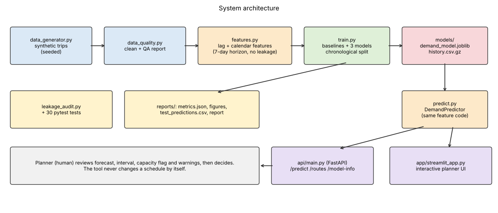

# 4. Data-quality checks and cleaning

The raw export deliberately contains the problems a real booking system export has:

| Issue | Rows | Handling |
|---|---|---|
| Exact duplicate trips | 403 | dropped (keep first `trip_id`) |
| Missing `capacity_seats` | 605 | filled with most common capacity for the same route + time slot |
| Missing `distance_km` | 303 | filled from the route master |
| Missing `passengers` | 808 | kept in calendar, excluded from training/evaluation |
| Impossible `passengers` (negative or > seats) | 313 | set to missing, excluded |
| Statistical outliers (robust z > 3.5 within route/slot/weekday) | 700 | **flagged, not removed**: mostly genuine disruptions |

After cleaning: 100,809 rows, 1117 without a valid target; 7.0% of valid trips are sold out (censored demand).

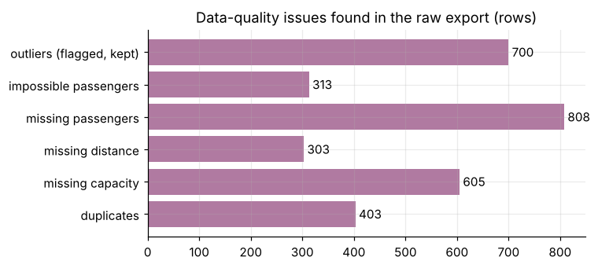

# 5. Exploratory data analysis

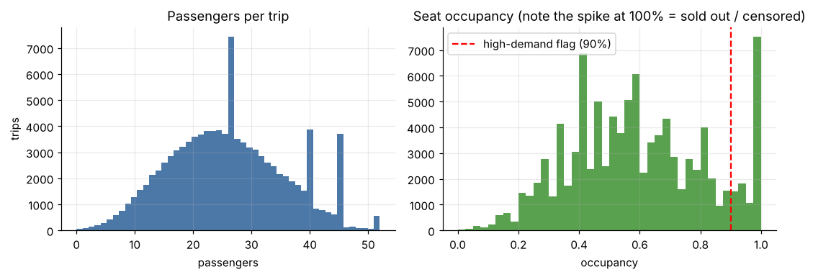

Mean occupancy is 58.9% and 7.0% of trips are sold out. The spike at 100 % is **censoring**: we observe seats sold, not true demand.

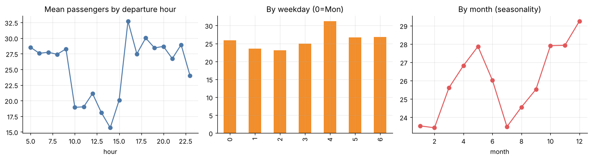

* Time of day matters and differs by route type (commuter peaks 06-10 and 16-20; tourist routes peak early morning).
* Weekday effects differ: intercity routes peak Friday/Sunday, tourist routes Saturday, commuter routes Monday/Friday.
* Seasonality: tourist routes peak in summer and December; a +5 %/year trend is visible.

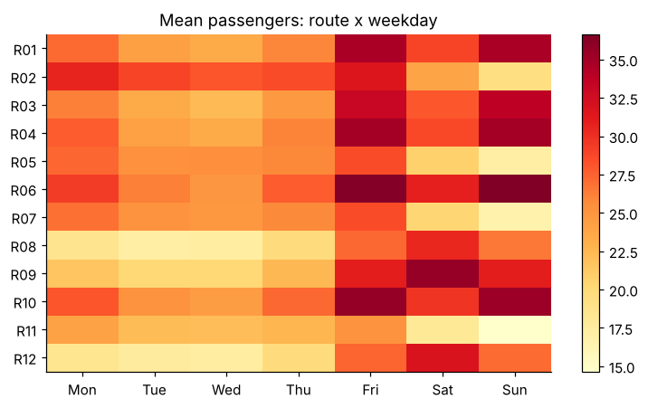
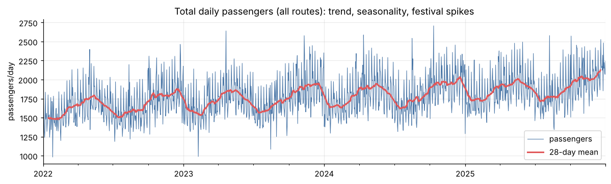

Festival and holiday periods produce visible spikes in the daily total. Full EDA with code is in `notebooks/01_eda.ipynb`.

# 6. Leakage analysis

| Risk | Control | Evidence |
|---|---|---|
| Using the trip's own outcome | `passengers`, `occupancy`, `sold_out`, `valid_target`, `outlier_flag` are forbidden inputs | `leakage_audit.check_forbidden_inputs` |
| Using information unknown 7 days ahead (rain, strikes) | never used as features | same check |
| History features peeking into the future | lags read only trips on or before departure date - 8 days (so same weekday last week is **not** used; the first lag is 14 days back) | unit test + audit: all data after the cutoff is overwritten with 9,999 and the features are unchanged (25 samples, 0 failures) |
| Random split mixing future into training | chronological split only | `check_split`: train < validation < test, no overlap |
| Tuning on test data | selection uses validation MAE only; test is evaluated once after refit | `train.py` stages 4-5 |
| Sensitive data | dataset has aggregate counts only, no passenger-level fields | `check_no_sensitive_columns` |

All audit checks passed: **True**. The calendar/holiday features are known months ahead, so they are legitimate.

# 7. Feature engineering

Numeric (21): `hour_decimal`, `is_weekend`, `is_peak_hour`, `is_holiday`, `is_major_festival`, `days_to_next_holiday`, `days_since_prev_holiday`, `next_holiday_major`, `doy_sin`, `doy_cos`, `distance_km`, `capacity_seats`, `lag1`, `lag2`, `lag3`, `lag4`, `lag_mean4`, `lag_occ_mean4`, `route_mean_28d`, `route_occ_28d`, `n_lags_available`.

Categorical (3): `route_id`, `dow`, `season`.

* **Recent-history features:** demand of the same route/slot on the last four same-weekdays that were observable at forecast time (`lag1..lag4`, mean), the same in occupancy terms (useful because capacity varies), and the route's average demand/occupancy over the last 28 observable days.
* **Calendar:** hour, weekday, weekend, season, day-of-year (sin/cos), peak-hour flag, holiday, major festival, days to next / since previous holiday, whether the next holiday is a major festival. The holiday calendar is approximate and synthetic-project specific.
* **Capacity features:** seat capacity of the planned bus and route distance.
* **Missing history** is imputed with the median in Ridge/Random forest and counted in `n_lags_available`.
* **Outliers** are not removed (they are genuine events). Predictions are clipped to [0, seat capacity].

# 8. Validation strategy

| Split | Dates | Trips | Purpose |
|---|---|---|---|
| Train | 2022-01-01 to 2025-06-30 | 84,282 | fit candidate models |
| Validation | 2025-07-01 to 2025-09-30 | 6,276 | tune and select the model |
| Test | 2025-10-01 to 2025-12-31 | 6,269 | final, untouched until the end; model and baselines are refit on train+validation |

The first 42 days are excluded because their lag history is incomplete. The test quarter (Oct-Dec) contains Dussehra, Diwali, Guru Nanak Jayanti and Christmas, so it is a demanding period.

# 9. Baselines, candidate models and tuning

* **Baseline A (required): route x departure slot x weekday historical average** with fall-backs (route x slot, then route). It is what a planner could compute in a spreadsheet.
* **Baseline B: seasonal naive**, the mean of the same slot on the last four observable same-weekdays.
* **Ridge regression** (linear, one-hot categories) - interpretable but cannot capture interactions such as route x time x weekday.
* **Random forest** - non-linear, robust, slower.
* **Gradient boosting (HistGradientBoostingRegressor)** - strong on tabular data; Poisson loss tested because the target is a count.

Hyper-parameters were chosen from small grids on **validation MAE only**:

| model | params | val_MAE |
|---|---|---|
| hist_gradient_boosting | {'loss': 'poisson', 'learning_rate': 0.1, 'max_leaf_nodes': 31} | 4.987 |
| hist_gradient_boosting | {'loss': 'squared_error', 'learning_rate': 0.1, 'max_leaf_nodes': 31} | 5.018 |
| hist_gradient_boosting | {'loss': 'squared_error', 'learning_rate': 0.1, 'max_leaf_nodes': 15} | 5.042 |
| hist_gradient_boosting | {'loss': 'poisson', 'learning_rate': 0.05, 'max_leaf_nodes': 31} | 5.043 |
| hist_gradient_boosting | {'loss': 'poisson', 'learning_rate': 0.1, 'max_leaf_nodes': 15} | 5.055 |
| hist_gradient_boosting | {'loss': 'squared_error', 'learning_rate': 0.05, 'max_leaf_nodes': 31} | 5.064 |
| hist_gradient_boosting | {'loss': 'poisson', 'learning_rate': 0.05, 'max_leaf_nodes': 15} | 5.118 |
| hist_gradient_boosting | {'loss': 'squared_error', 'learning_rate': 0.05, 'max_leaf_nodes': 15} | 5.137 |
| random_forest | {'min_samples_leaf': 5, 'max_features': 0.5} | 5.363 |
| random_forest | {'min_samples_leaf': 20, 'max_features': 0.5} | 5.472 |
| ridge | {'alpha': 0.1} | 5.771 |
| ridge | {'alpha': 1.0} | 5.771 |
| ridge | {'alpha': 10.0} | 5.771 |
| ridge | {'alpha': 100.0} | 5.773 |

Selected: **Gradient boosting (HistGB)**, parameters `{'loss': 'poisson', 'learning_rate': 0.1, 'max_leaf_nodes': 31}`.

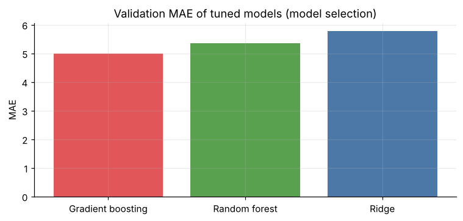

# 10. Results on the held-out test set

| Method | Val MAE | Test MAE | Test RMSE | Test WAPE | Test bias |
|---|---|---|---|---|---|
| Baseline A: route/time average | 5.352 | 6.249 | 7.843 | 20.9% | -4.091 |
| Baseline B: seasonal naive (last 4 same weekdays) | 6.136 | 5.803 | 7.420 | 19.4% | -1.085 |
| Ridge regression | 5.771 | 5.701 | 7.106 | 19.0% | -1.574 |
| Random forest | 5.363 | 5.265 | 6.532 | 17.6% | -1.404 |
| Gradient boosting (HistGB) | 4.987 | 4.941 | 6.175 | 16.5% | -1.326 |

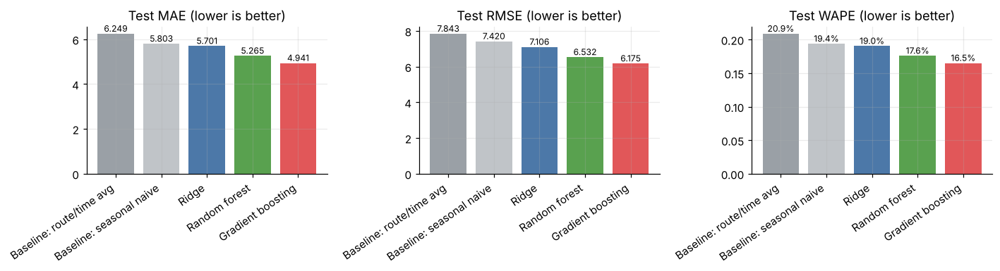

* The selected model reduces WAPE from 20.9% to 16.5% (20.9% relative) and MAE from 6.25 to 4.94 passengers versus Baseline A.
* The ranking on validation and test is consistent (gradient boosting < random forest < ridge < baselines on MAE), which suggests the selection was not overfitted to the validation quarter.
* **Business meaning:** an average miss of 4.9 passengers on a 40-52 seat bus. Baseline A under-forecasts by 4.1 passengers on average (it cannot see growth, season or holidays), the model by 1.3. Under-forecasting is the costly direction because it means turned-away passengers.

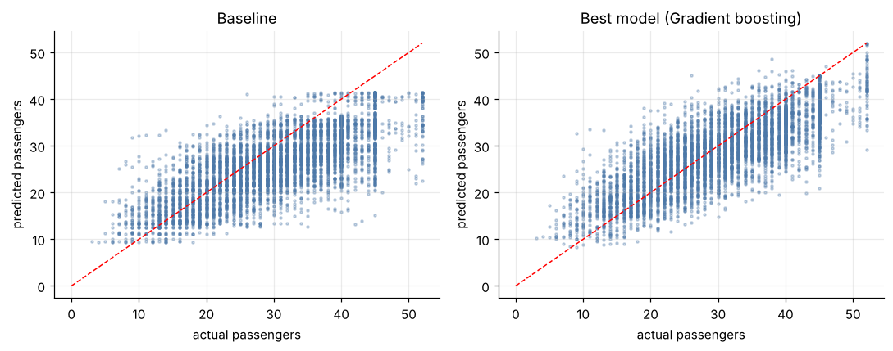
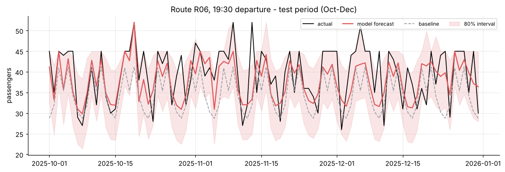

# 11. Error analysis

## 11.1 By route

| Route | n | Baseline A WAPE | Model WAPE | Baseline A MAE | Model MAE |
|---|---|---|---|---|---|
| R01 | 549 | 20.2% | 15.0% | 6.695 | 4.968 |
| R02 | 637 | 17.8% | 15.0% | 5.257 | 4.426 |
| R03 | 543 | 20.8% | 15.5% | 6.687 | 4.982 |
| R04 | 455 | 21.6% | 17.0% | 7.285 | 5.740 |
| R05 | 546 | 18.9% | 17.3% | 4.941 | 4.529 |
| R06 | 541 | 19.4% | 14.2% | 6.832 | 5.022 |
| R07 | 548 | 19.8% | 17.8% | 5.227 | 4.692 |
| R08 | 451 | 24.6% | 18.9% | 6.737 | 5.159 |
| R09 | 363 | 25.6% | 18.1% | 8.219 | 5.806 |
| R10 | 548 | 18.8% | 14.2% | 6.336 | 4.793 |
| R11 | 635 | 21.6% | 19.3% | 5.013 | 4.484 |
| R12 | 453 | 25.5% | 19.1% | 7.223 | 5.397 |

The model has lower WAPE than Baseline A on **12 of 12 routes**. The tourist routes (R08, R09, R12) are hardest because their demand is more volatile and seasonal.

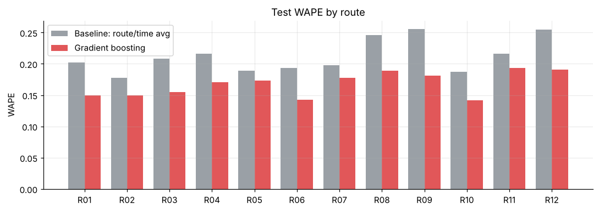

## 11.2 Peak vs off-peak

| Period | n | Baseline A MAE | Model MAE | Baseline A WAPE | Model WAPE | Model bias |
|---|---|---|---|---|---|---|
| off-peak | 2536 | 6.063 | 4.770 | 23.0% | 18.1% | -1.415 |
| peak | 3733 | 6.376 | 5.058 | 19.7% | 15.6% | -1.266 |

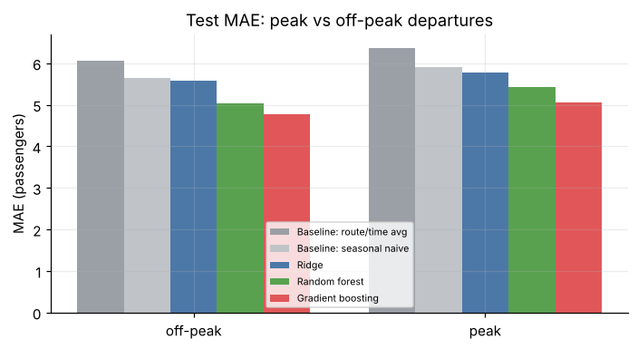

## 11.3 Holidays, weekends and disruptions

| Day type | n | Baseline A MAE | Model MAE | Baseline A WAPE | Model WAPE | Model bias |
|---|---|---|---|---|---|---|
| holiday | 272 | 7.098 | 4.915 | 28.7% | 19.9% | -1.835 |
| weekday | 4222 | 6.267 | 4.985 | 20.9% | 16.7% | -1.273 |
| weekend | 1775 | 6.078 | 4.841 | 19.7% | 15.7% | -1.374 |

| Day status | n | Baseline A MAE | Model MAE | Baseline A WAPE | Model WAPE | Model bias |
|---|---|---|---|---|---|---|
| disruption | 6 | 16.082 | 16.511 | 139.8% | 143.6% | 16.511 |
| normal | 6263 | 6.240 | 4.930 | 20.8% | 16.5% | -1.343 |

* The model helps most on **holidays**, where Baseline A has the largest error.
* On the 6 test trips that fell on a hidden disruption (strike/closure) the model is **not** better than the baseline (MAE 16.5 vs 16.1) - nobody can forecast an unannounced strike 7 days ahead. Because only 6 trips are involved, this estimate is very uncertain.

## 11.4 Censoring and the worst errors

* On trips that actually sold out the model's MAE is 6.65 (bias -6.65) versus 4.67 on the rest: the observed count is capped by seats, so the model learns a conservative picture of the busiest trips.
* The worst 5 % of trips account for 15% of all absolute error.

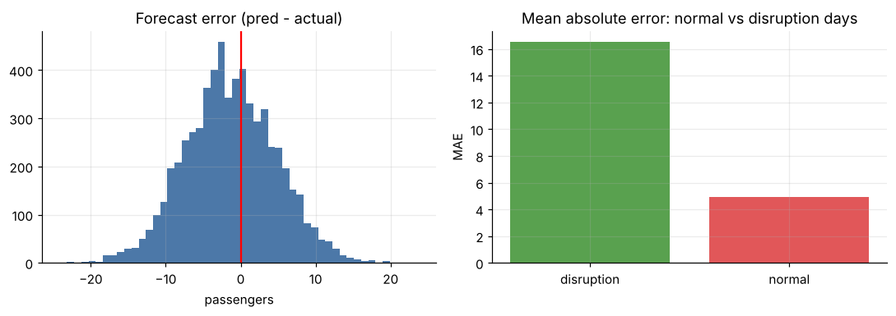

# 12. Capacity-aware flags and uncertainty

Flags use the predicted occupancy: **HIGH_DEMAND >= 90%** (consider an extra bus), **ELEVATED >= 75%** (keep a standby bus), **LOW_DEMAND <= 40%** (consider a smaller bus), otherwise NORMAL. The 90 % and 40 % thresholds were set up front. The 75 % ELEVATED tier was added after I saw that the 90 % rule had low recall on the test set; it is a round-number rule that was not tuned on test, but because it was motivated by that observation its test results are mildly optimistic. A real operator should set all thresholds from actual costs. The API also reports `sell_out_risk` when the top of the 80 % interval reaches the seat capacity.

Evaluation of the flag as a classifier of "this trip ends up >= 90 % full" (test set):

| Method | Flag rule | Precision | Recall | F1 | Flagged | Actually >=90% full |
|---|---|---|---|---|---|---|
| Baseline A: route/time average | HIGH (pred occ>=90%) | 0.84 | 0.08 | 0.15 | 127 | 1325 |
| Baseline A: route/time average | WATCH+HIGH (pred occ>=75%) | 0.61 | 0.52 | 0.56 | 1135 | 1325 |
| Baseline B: seasonal naive (last 4 same weekdays) | HIGH (pred occ>=90%) | 0.62 | 0.29 | 0.40 | 624 | 1325 |
| Baseline B: seasonal naive (last 4 same weekdays) | WATCH+HIGH (pred occ>=75%) | 0.46 | 0.73 | 0.56 | 2100 | 1325 |
| Gradient boosting (HistGB) | HIGH (pred occ>=90%) | 0.81 | 0.25 | 0.38 | 410 | 1325 |
| Gradient boosting (HistGB) | WATCH+HIGH (pred occ>=75%) | 0.55 | 0.78 | 0.64 | 1892 | 1325 |

* The strict 90 % rule is precise but misses most full trips (a mean forecast rarely reaches 90 %).
* The 75 % WATCH rule catches most full trips with the model (recall 78%, precision 55%) and has a better F1 than both baselines. About 45% of its alerts are false alarms; that is acceptable only because an unused standby bus is cheaper than turning passengers away.

**Prediction intervals** use split-conformal calibration on validation residuals, separately for peak and off-peak. The 80 % interval covers **79.9%** of test trips and the 90 % interval 91.1% (targets 80 % and 90 %), with mean 80 % width 15.3 passengers. Intervals are widened automatically when history is stale, the departure time is unknown to the route, or the date is outside the holiday calendar.

# 13. Explainability

**Global (permutation importance on test):**

| Rank | Input | Test MAE increase if shuffled |
|---|---|---|
| 1 | average same-slot demand (last 4 same weekdays) | 1.906 |
| 2 | route distance | 1.141 |
| 3 | day of week | 0.740 |
| 4 | peak-hour departure | 0.659 |
| 5 | days until next holiday | 0.453 |
| 6 | departure time of day | 0.448 |
| 7 | weekend | 0.255 |
| 8 | route's average occupancy, last 28 days | 0.198 |
| 9 | route | 0.167 |
| 10 | public holiday | 0.160 |
| 11 | route's average demand, last 28 days | 0.099 |
| 12 | time of year (cos) | 0.065 |

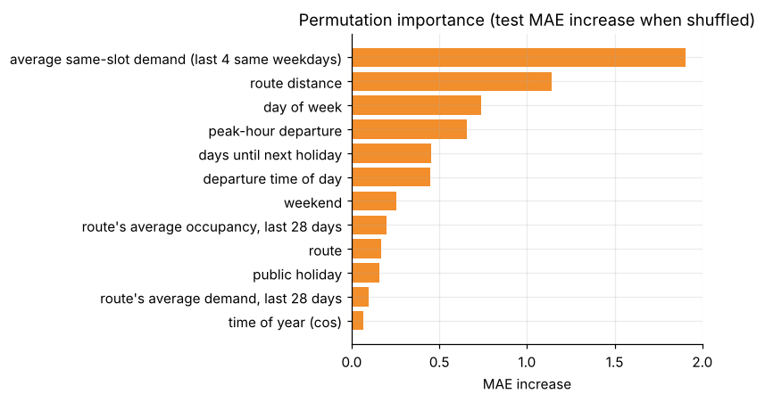

Recent same-slot demand and route identity/length dominate, followed by weekday, peak hour and holiday proximity, which matches the generating process and common sense.

**Local explanations** replace each input by its typical training value and report the change in the forecast (an approximation that ignores interactions).

*Typical prediction:*

**R07-20251125-1700** (2025-11-25 17:00:00, capacity 40): actual **33**, model **28.8**, baseline 27.5.

| Input | This trip | Typical value | Effect on forecast |
|---|---|---|---|
| departure time of day | 17.0 | 12.5 | +3.0 |
| season | post_monsoon | summer | +1.9 |
| average same-slot demand (last 4 same weekdays) | 30.25 | 25.75 | +1.5 |
| average same-slot occupancy (last 4 same weekdays) | 0.74 | 0.576 | -1.5 |
| time of year (sin) | -0.584 | 0.171 | -0.8 |
| route distance | 65.0 | 220.0 | +0.8 |

*Largest error without a disruption:*

**R08-20251225-1200** (2025-12-25 12:00:00, capacity 45): actual **45**, model **20.9**, baseline 15.1.

| Input | This trip | Typical value | Effect on forecast |
|---|---|---|---|
| time of year (sin) | -0.107 | 0.171 | +7.4 |
| average same-slot demand (last 4 same weekdays) | 17.0 | 25.75 | -5.5 |
| public holiday | 1 | 0.0 | +2.1 |
| days until next holiday | 7 | 10.0 | +1.5 |
| peak-hour departure | 0 | 1.0 | -1.1 |
| same-slot demand 5 weeks ago | 13.0 | 25.0 | +0.6 |

Why it went wrong: Christmas Day on a tourist route is rare in the training data (one per year) and the trip sold out, so the model under-reacts to the holiday uplift. This is a limitation for unusual events, not a bug in the pipeline.

*Largest error during a disruption:*

**R02-20251119-0730** (2025-11-19 07:30:00, capacity 40): actual **9**, model **32.7**, baseline 31.8.

| Input | This trip | Typical value | Effect on forecast |
|---|---|---|---|
| average same-slot demand (last 4 same weekdays) | 30.75 | 25.75 | +3.7 |
| route's average occupancy, last 28 days | 0.736 | 0.589 | +2.4 |
| departure time of day | 7.5 | 12.5 | +2.4 |
| average same-slot occupancy (last 4 same weekdays) | 0.769 | 0.576 | -2.3 |
| route | R02 | R11 | +2.0 |
| route distance | 100.0 | 220.0 | +1.6 |

The model sees normal history and normal calendar features; the strike is invisible to it, so the forecast is far too high.

# 14. Inference interface

* **API:** `uvicorn api.main:app` -> `POST /predict`, `POST /predict/batch`, `GET /routes`, `GET /model-info`, `GET /health`, Swagger UI at `/docs`.
* **App:** `streamlit run app/streamlit_app.py` -> choose route/date/time/capacity, see forecast, interval, flag, warnings, history chart and drivers, plus a model-performance tab.
* Both call `DemandPredictor`, which **loads `models/demand_model.joblib`** and builds features with the **same code used in training** (`busdemand/features.py`), so there is no training/serving skew. Responses are never hard-coded; tests check that different inputs give different outputs and that the API equals a direct call to the model.
* For dates up to the end of the data (2025-12-31) the tool runs as a **backtest** and shows the actual value for comparison; later dates are true forecasts with a stale-history warning and wider interval.

# 15. Responsible use, bias, privacy and failure modes

* **Human oversight:** every response states `human_review_required: true`. The tool recommends; a planner decides. It is not suitable for automated high-stakes decisions such as cancelling a route.
* **Privacy:** only aggregate trip-level counts are used; the dataset has no passenger identities and no personal fields. Real deployments should keep it that way (no passenger-level tracking, no demographic features).
* **Representativeness and bias:** the data is synthetic and the generating assumptions are mine. Real ridership would under-represent people who cannot or do not book digitally (cash/counter passengers, informal travel) and people priced out of travelling, so a model trained on bookings may systematically under-serve those groups' routes. Forecasting only *boarded* passengers can create a feedback loop: routes that are under-served look less busy, receive less capacity, and look even less busy. Monitoring turned-away and unmet demand is needed to break the loop.
* **Failure modes:** new routes and new departure times (no history; warned and widened); disruptions and unusual events (not forecastable; warned in the UI); sold-out censoring; stale history; holiday calendar gaps; distribution shift (new competitors, fare changes, structural breaks such as a pandemic). Drift should be monitored by tracking rolling WAPE and retraining.
* **Single test window:** the test period is one quarter; it does not prove performance in every season.

# 16. Reproducibility and testing

* One command reproduces everything: `python run_all.py` (generate data -> clean -> train/evaluate -> report -> notebooks -> tests). Fixed seed 42; re-running gives identical metrics (verified by running training twice).
* Saved artifact `models/demand_model.joblib` (+ `models/history.csv.gz` for inference lag look-ups). If your scikit-learn version differs, re-run `python -m busdemand.train` (about 2 minutes).
* `requirements.txt` (ranges) and `requirements-lock.txt` (exact tested versions).
* **30 automated tests** covering cleaning rules, calendar, lag-feature correctness, future-data invariance (leakage), metric formulas, chronological masks, baseline fall-backs, generator determinism, model loading, prediction validity, warnings, and the API (including equality with a direct model call and error handling).

# 17. Known incomplete features and assumptions

* Synthetic data only; no real operator data was validated.
* Holiday calendar is approximate and limited to 2022-2027.
* Single route-level model (not one per route) and a single test window; no rolling-origin cross-validation.
* No booking-curve features (bookings already made 7 days before departure), which would improve accuracy substantially in a real system.
* Uncertainty is residual-based (split conformal), not conditional on route.
* Demand beyond seat capacity is not modelled (censoring is documented, not corrected).

# 18. AI tools and attribution

*(Edit this section so it is a truthful description of how you worked.)*

* **AI tools used:** Claude (Anthropic) assisted with project scaffolding, code and drafting of this report. I reviewed, ran and tested the code and can explain every module.
* **Libraries:** pandas, NumPy, scikit-learn, SciPy, matplotlib, joblib, FastAPI, Uvicorn, Pydantic, Streamlit, pytest, nbformat/nbconvert (all open source).
* **Data:** fully synthetic, generated by this repository; no external dataset or licence involved. The holiday dates are public-knowledge approximations.
